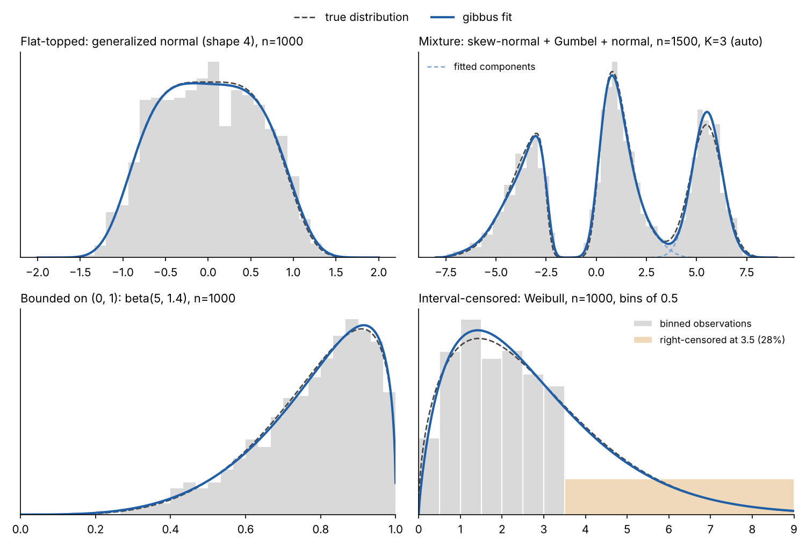

# gibbus

[](https://pypi.org/project/gibbus/)
[](https://pypi.org/project/gibbus/)
[](LICENSE)

Gibbus is a Python library for fitting smooth univariate probability
distributions to data. Instead of committing to a parametric family, it fits a
flexible log-concave density by maximum likelihood. One model covers shapes
that would otherwise call for a normal, gamma, beta, Weibull, Gumbel, or
something in between. Multimodal data is fitted as a mixture of log-concave
components.



*Fits to simulated data. The bounded and censored fits enable the boundary
terms for endpoints where the density falls to zero; the others use default
settings. The figure is generated by
[readme_figure.py](docs/images/readme_figure.py).*

## Installation

```bash
pip install gibbus
```

Gibbus requires Python 3.10 or later, NumPy and SciPy.

## Example

```python
import numpy as np
from gibbus import Distribution

rng = np.random.default_rng(0)
samples = rng.gamma(2.5, size=400)

model = Distribution().fit(samples, support=(0, np.inf))

model.pdf([0.5, 2.0, 5.0])
model.cdf(2.0)
model.ppf(0.99)
model.mean, model.std
model.sample(100, rng=rng)
```

Interval-censored observations are given as `[lower, upper]` rows, with an
infinite bound for left or right censoring. Mixtures take a fixed number of
components or `"auto"`.

```python
intervals = np.column_stack([np.floor(samples), np.floor(samples) + 1])
intervals[samples > 6] = [6, np.inf]
censored = Distribution().fit(intervals, support=(0, np.inf))

bimodal = np.r_[rng.normal(-2, 0.5, 300), rng.normal(2, 0.7, 300)]
mixture = Distribution().fit(bimodal, n_components="auto", rng=0)
mixture.weights
```

## Features

- Exact, interval-censored, and left- or right-censored observations, with
  optional weights
- Full-line, half-line, and bounded supports, including densities that fall
  to zero at a boundary, as gamma and beta densities do
- Mixtures with a fixed or automatically chosen number of components
- Tail probabilities and extreme quantiles that remain accurate far past the
  point where `1 - cdf` loses precision
- Moments, entropy, survival and hazard functions, sampling, affine
  transforms, and truncation
- Goodness-of-fit tests, bootstrap confidence bands, and fit diagnostics
- Fitted models saved as plain NumPy arrays that load without pickle

## How it works

Each component has density proportional to `exp(-V(x))`, where `V` is a
combination of polynomial, boundary, and tail terms. The fit maximizes the
likelihood subject to `V` being convex over the whole support, which is
exactly the condition for log-concavity. The polynomial degree, and with it
the flexibility of the fit, is chosen from the data. The fitted density is a
closed-form function rather than a grid or a sum of kernels.

See [Modeling concepts](docs/modeling-concepts.md) for details.

## Documentation

- [Getting started](docs/getting-started.md)
- [Fitting](docs/fitting.md)
- [Using fitted distributions](docs/using-distributions.md)
- [Diagnostics](docs/diagnostics.md)
- [All documentation](docs/README.md)

## Development status

This repository is a development snapshot and may be ahead of the release on
PyPI. To install it from source, run `pip install .` in the repository root;
building requires C and C++ compilers.

## Citation and license

Citation information is in [CITATION.cff](CITATION.cff). Gibbus is released
under the [MIT license](LICENSE). Contributions are welcome; see
[CONTRIBUTING.md](CONTRIBUTING.md).
